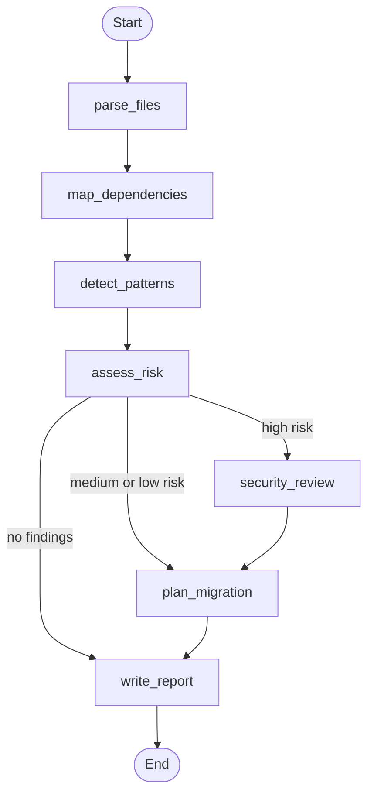

# Legacy Code Modernization Assistant

Analyzes legacy C# (.NET Framework) code and produces a modernization report with detected security risks and migration blockers, a file dependency diagram, and a phased migration plan. The workflow is orchestrated with LangGraph, and the migration plan is Pydantic structured output generated either by OpenAI or by an offline rule-based planner.

The code in `sample_legacy_app/` is synthetic and was written for this project.

## Features

- Extracts namespaces, types, methods, and `using` directives from C# files
- Maps dependencies between files and renders them as a Mermaid diagram
- Detects security risks and .NET Framework migration blockers with a rule catalog
- Routes high-risk codebases through a security review step before planning
- Generates a phased migration plan with OpenAI structured output, or offline without an API key
- Exposes the analysis as a FastAPI endpoint with input validation
- Covered by pytest tests for the analyzer, graph routing, LLM wiring, and API

## Workflow



| Node | What it does |
|---|---|
| `parse_files` | Extracts namespaces, types, methods, and `using` directives |
| `map_dependencies` | Finds files that reference types defined in other files |
| `detect_patterns` | Applies the detection rules line by line |
| `assess_risk` | Sets the overall risk to the highest finding severity |
| `security_review` | Lists high-severity issues that must be fixed before migration |
| `plan_migration` | Builds the phased plan with OpenAI or the offline planner |
| `write_report` | Renders the Markdown report |

## Detection rules

| Rule | Severity | Detects | Recommendation |
|---|---|---|---|
| SEC001 | High | SQL built with string concatenation | Parameterized queries or EF Core |
| SEC002 | High | Hard-coded credentials in a connection string | Environment variables or Azure Key Vault |
| SEC003 | Medium | Service calls over plain HTTP | HTTPS with a configurable endpoint |
| LEG001 | Medium | `System.Data.SqlClient` | `Microsoft.Data.SqlClient` or EF Core |
| LEG002 | Medium | Windows Forms on .NET Framework | WinForms on modern .NET or Blazor |
| LEG003 | Medium | `HttpContext.Current` | `IHttpContextAccessor` in ASP.NET Core |
| LEG004 | Medium | WCF `[ServiceContract]` | ASP.NET Core Web API, gRPC, or CoreWCF |
| LEG005 | Low | `ConfigurationManager` | `IConfiguration` with `appsettings.json` |
| LEG006 | Low | `WebClient` | `HttpClient` through `IHttpClientFactory` |

## Run

```powershell
py -m pip install -r requirements.txt
py main.py
```

This analyzes `sample_legacy_app/` and writes `modernization_report.md`. To analyze another folder:

```powershell
py main.py C:\path\to\legacy\code --output reports\legacy_report.md
```

To have OpenAI write the migration plan, copy `.env.example` to `.env`, add your own API key, and run:

```powershell
py main.py --openai
```

Without `--openai`, no source code leaves your machine.

## REST API

```powershell
py -m uvicorn api:app --reload
```

Open http://127.0.0.1:8000/docs and call `POST /analyze` with a JSON body that maps C# file names to their contents:

```json
{
  "files": {
    "CustomerRepository.cs": "using System.Data.SqlClient;\n..."
  }
}
```

Requests are limited to 50 `.cs` files of up to 200,000 characters each.

## Tests

```powershell
py -m pytest -q
```

## Sample output

[sample_output/modernization_report.md](sample_output/modernization_report.md) was generated from `sample_legacy_app/`.

## Design decisions

- **Rules detect, the LLM plans.** Detection is deterministic, so the same code always produces the same findings and can be unit tested. The LLM writes the migration plan, where prioritization and wording benefit from judgment, and its output is constrained to the `MigrationPlan` Pydantic schema.
- **LangGraph for routing.** Each step is a node that reads and updates shared state. Conditional edges send high-risk code through a security review and skip planning when nothing needs to change. New steps, such as human approval, can be added as nodes.
- **Offline by default.** Enterprise source code is often confidential, so the default mode makes no external calls. OpenAI is opt-in.
- **Validated API input.** The endpoint accepts file contents rather than server paths, so callers cannot read files from the server, and request size is capped.

## Limitations and next steps

- Parsing uses regular expressions, not a full C# parser. Roslyn would give accurate syntax trees.
- Rules are applied line by line, so patterns that span several lines can be missed.
- LLM-generated plans are not evaluated automatically. A next step is an evaluation set that scores plans against expected phases.
- Possible extensions: retrieval over Microsoft migration guides (RAG), a human-approval node, and a code-generation node that proposes fixes with tests.
