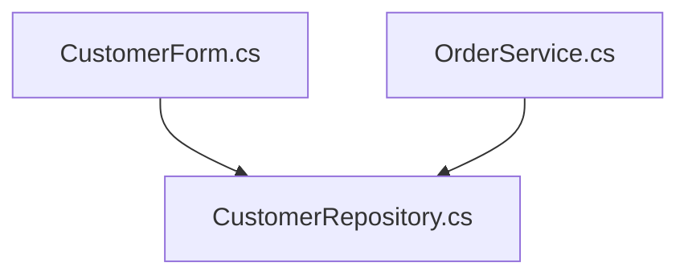

# Legacy Modernization Report

**Overall risk:** HIGH

| Files | Lines | Types | Methods | Findings |
|---|---|---|---|---|
| 3 | 137 | 5 | 6 | 11 |

## Dependency Diagram

## Findings

| Severity | Rule | Location | Issue | Recommendation |
|---|---|---|---|---|
| HIGH | SEC001 | CustomerRepository.cs:18 | SQL query built with string concatenation (SQL injection risk) | Use parameterized queries or Entity Framework Core. |
| HIGH | SEC001 | CustomerRepository.cs:40 | SQL query built with string concatenation (SQL injection risk) | Use parameterized queries or Entity Framework Core. |
| HIGH | SEC002 | OrderService.cs:22 | Hard-coded credentials in a connection string | Move secrets to environment variables or Azure Key Vault. |
| MEDIUM | LEG002 | CustomerForm.cs:3 | Windows Forms UI on .NET Framework | Port to Windows Forms on modern .NET or re-platform the UI to Blazor. |
| MEDIUM | SEC003 | CustomerForm.cs:32 | Service call over unencrypted HTTP | Use HTTPS and read the endpoint from configuration. |
| MEDIUM | LEG001 | CustomerRepository.cs:4 | Legacy System.Data.SqlClient data provider | Migrate to Microsoft.Data.SqlClient or Entity Framework Core. |
| MEDIUM | LEG001 | OrderService.cs:2 | Legacy System.Data.SqlClient data provider | Migrate to Microsoft.Data.SqlClient or Entity Framework Core. |
| MEDIUM | LEG004 | OrderService.cs:9 | WCF service contract | Expose the operation as an ASP.NET Core Web API or gRPC service, or use CoreWCF. |
| MEDIUM | LEG003 | OrderService.cs:28 | HttpContext.Current is not available in ASP.NET Core | Inject IHttpContextAccessor or pass the user identity explicitly. |
| LOW | LEG006 | CustomerForm.cs:30 | Obsolete WebClient API | Use HttpClient through IHttpClientFactory. |
| LOW | LEG005 | CustomerRepository.cs:11 | Configuration read through ConfigurationManager | Use IConfiguration with appsettings.json and environment variables. |

## Security Review

Resolve these issues before starting the migration:

- CustomerRepository.cs:18 - SQL query built with string concatenation (SQL injection risk). Use parameterized queries or Entity Framework Core.
- CustomerRepository.cs:40 - SQL query built with string concatenation (SQL injection risk). Use parameterized queries or Entity Framework Core.
- OrderService.cs:22 - Hard-coded credentials in a connection string. Move secrets to environment variables or Azure Key Vault.

## Migration Plan

11 findings across 3 files with high overall risk.

### Phase 1: Security remediation

- Use parameterized queries or Entity Framework Core. [CustomerRepository.cs]
- Move secrets to environment variables or Azure Key Vault. [OrderService.cs]
- Use HTTPS and read the endpoint from configuration. [CustomerForm.cs]

### Phase 2: Platform migration

- Port to Windows Forms on modern .NET or re-platform the UI to Blazor. [CustomerForm.cs]
- Migrate to Microsoft.Data.SqlClient or Entity Framework Core. [CustomerRepository.cs, OrderService.cs]
- Expose the operation as an ASP.NET Core Web API or gRPC service, or use CoreWCF. [OrderService.cs]
- Inject IHttpContextAccessor or pass the user identity explicitly. [OrderService.cs]

### Phase 3: Modernization cleanup

- Use HttpClient through IHttpClientFactory. [CustomerForm.cs]
- Use IConfiguration with appsettings.json and environment variables. [CustomerRepository.cs]
